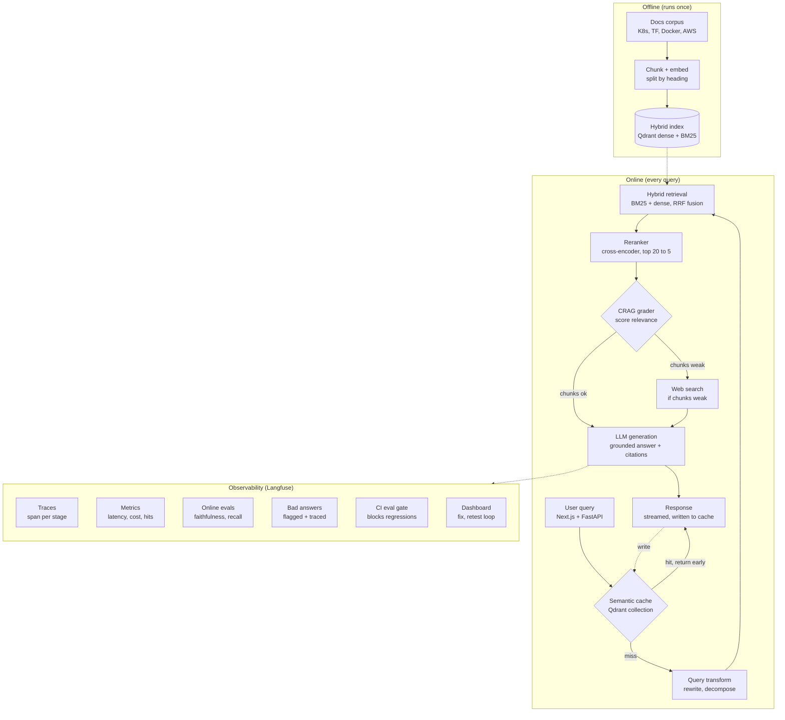

# OpsRAG system design

Notes:
- Offline ingestion is a short script: gather the four doc sets (git clones plus AWS `.md` pages), clean them, split pages by heading, embed, load into Qdrant (dense + BM25).
- A semantic cache hit skips the whole pipeline. A miss runs transform, retrieval, rerank, grading and generation, and the final response is written back to the cache.
- The CRAG grader sends weak chunk sets to web search before generation. Strong sets go straight to the LLM.
- Every online stage emits a trace span. The dashed edge into the observability panel stands for that telemetry. Weak answers are flagged, traced to the failing stage, fixed, and re-tested behind the CI eval gate.
