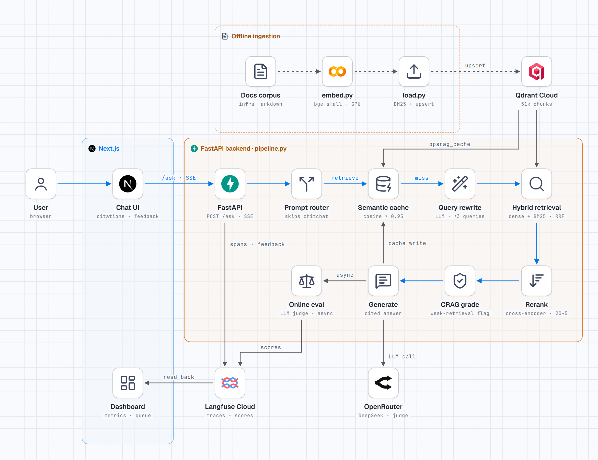
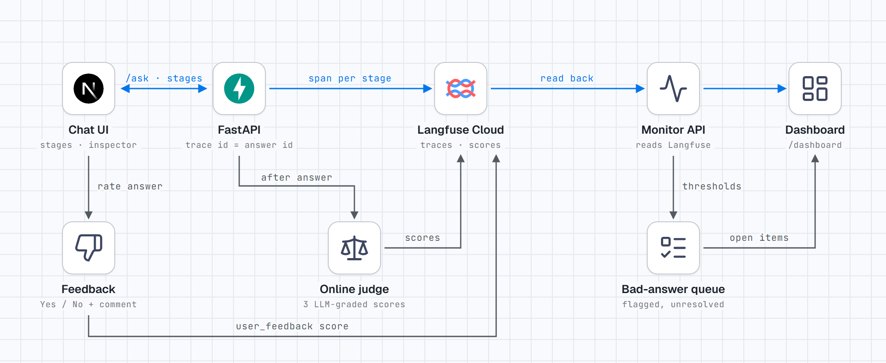

# OpsRAG

A RAG copilot for Kubernetes, Docker, Terraform and AWS docs. Every answer is traced, so a bad one can be pinned to the stage that broke.

**Problem.** When a RAG answer is wrong, you usually can't tell why. Retrieval may have missed, the reranker may have dropped the right chunk, or the LLM may have made it up. Infra questions make it harder, because they mix exact names like `aws_iam_role_policy_attachment` with vague ones like "my pod keeps restarting".

**Solution.** BM25 and dense search fused with RRF, a cross-encoder reranker, a check that flags weak retrieval instead of guessing, and a semantic cache. Each stage is a Langfuse span. A background judge grades every fresh answer, and bad answers land in a review queue linked to their trace.

**What I learned.**
- Measure before adding stages. The LLM query rewrite lowered recall@5 (0.943 vs 0.971) and cost about 2 s, so it's off. I skipped HyDE for the same reason.
- Pick thresholds from data. Reranker scores split answerable and unanswerable questions by a wide margin, so the weak flag is easy. The cache was harder. 0.95 is the lowest cut-off with zero wrong hits, and it only catches 57% of paraphrases.
- Hidden reasoning tokens were the biggest latency cost. Turning them off saved about 10 s per LLM call.
- Check the labels first. Two of the first eval "misses" were wrong labels.
- Coverage beats tuning. "What are the AWS Support plans?" failed because that page wasn't in the corpus.

## System design

<picture>
  <source media="(prefers-color-scheme: dark)" srcset="docs/system-design-dark.png">
  
</picture>

## Benchmarks

37 questions (35 answerable, 2 unanswerable), run through the real pipeline. An LLM judge (`openai/gpt-6-luna`) grades the answers.

| Metric | Score |
| --- | --- |
| recall@20 | **1.000** |
| recall@5 (after rerank) | **0.971** |
| MRR@5 | 0.736 |
| weak-retrieval flag accuracy | **1.000** |
| faithfulness | 0.967 |
| answer relevancy | 0.971 |
| router false skips (n = 230) | **0** |
| cache wrong hits at 0.95 | **0** (57% of paraphrases hit) |

Retrieval scores were re-checked on 2026-11-04 against the live 51k-chunk index and matched. Judge scores are from 2026-11-02. It's a small set, so treat it as a regression baseline. Details are in [docs/BENCHMARK.md](docs/BENCHMARK.md).

```bash
uv run python evals/run.py --no-transform --check   # retrieval + regression gate
uv run python evals/run.py --no-transform --judge   # adds LLM-graded answer quality
```

## Observability

<picture>
  <source media="(prefers-color-scheme: dark)" srcset="docs/observability-dark.png">
  
</picture>

Each answer is one Langfuse trace with a span per stage. After the answer streams, a background judge adds faithfulness and relevancy scores, and the Yes/No buttons add a feedback score. Answers with a thumbs-down, weak retrieval or low scores go to the bad-answer queue on `/dashboard`, and each one links to its trace. All of this lives in Langfuse, with no local database.

## Setup

You need uv, Node.js, an OpenRouter key, Qdrant (Cloud or Docker) and optionally Langfuse keys.

```bash
uv sync
cp .env.example .env                               # fill in the keys

uv run python util_scripts/download_aws.py         # AWS docs into data/ (others: see CLAUDE.md)
uv run python backend/embed.py                     # chunk + embed (use a Colab GPU for the full corpus)
uv run python backend/load.py                      # add BM25, upsert into Qdrant

uv run uvicorn app:app --app-dir backend --port 8000
cd frontend && npm install && npm run dev          # http://localhost:3000, dashboard at /dashboard
```

For local Qdrant, run `docker compose up -d qdrant` and set `QDRANT_URL=http://localhost:6333`.

## Known gaps

- [ ] Web-search fallback for questions the docs don't cover
- [ ] Calibrate the bad-answer queue thresholds
- [ ] Cut uncached latency (about 10 s on a laptop)
- [ ] Better cache embedder, since bge-small confuses near-duplicate questions
- [ ] Auth, rate limiting, CI and deployment
